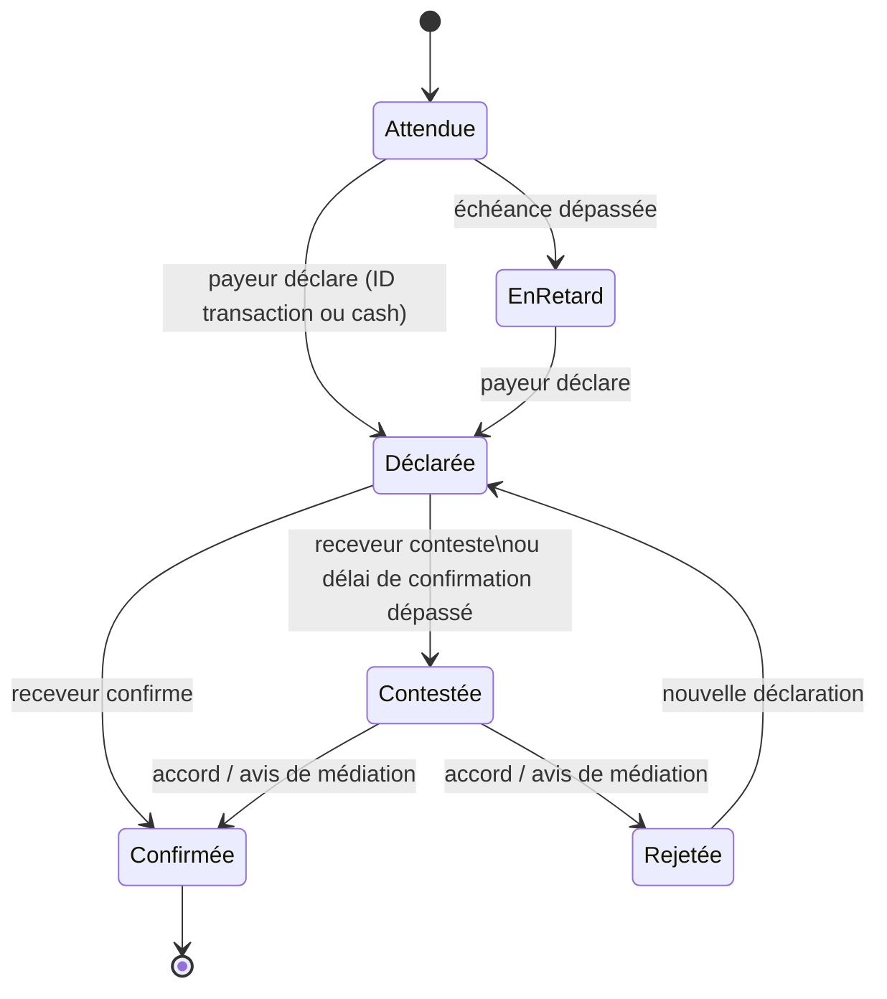
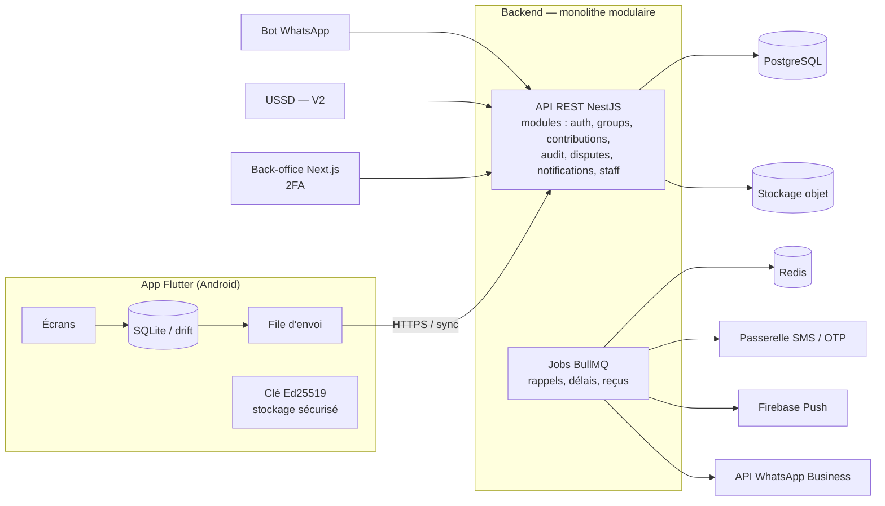

# Mchango — Cadrage et architecture

> Version 0.2 — 20 octobre 2026 — document de travail

Mchango (« contribution » en swahili) est une application de tontine digitale (likelemba / muziki) pour toute la population de la RDC : formelle (fonctionnaires, employés, professions libérales) et informelle (marchands, taxi-motos, artisans, associations de femmes, églises).

Elle rend chaque cotisation **vérifiable et transparente** sans jamais **détenir, transférer ni garantir l'argent des membres**.

- **App mobile Android (Flutter)** : pour les membres.
- **Back-office web (Next.js, 2FA)** : pour l'équipe.
- **Canaux complémentaires** : SMS, bot WhatsApp, USSD (V2).

Pilote prévu : 10 à 20 groupes à Lubumbashi.

---

## 1. Principes directeurs

| # | Principe | Conséquence concrète |
|---|----------|----------------------|
| P1 | **Non-détention des fonds** | Aucun compte, wallet, cagnotte ni **table de solde**. L'argent circule de membre à membre (M-Pesa, Airtel Money, Orange Money, cash). Mchango enregistre des **déclarations et des confirmations**, pas des paiements. |
| P2 | **Paiement direct au bénéficiaire** (par défaut) | Chaque membre paie directement le bénéficiaire du tour : pas d'intermédiaire qui pourrait détourner. Le mode « trésorier collecteur » reste possible, mais affiché comme plus risqué. |
| P3 | **Double regard** | Une cotisation n'est « confirmée » que si le payeur la déclare **et** que le receveur (bénéficiaire ou trésorier) la confirme. Une seule voix ne suffit jamais. |
| P4 | **Journal infalsifiable** | Ajout seul, hash chaîné, signé par l'appareil de l'auteur. Un membre peut vérifier que l'historique n'a pas été réécrit, même par Mchango. |
| P5 | **Hors-ligne et léger** | Réseau faible, data chère, téléphones d'entrée de gamme : fonctionne sans connexion, synchronise ensuite, APK léger. |
| P6 | **Langues** | Français d'abord, puis swahili et lingala. |
| P7 | **Montants exacts** | Devise par groupe (CDF ou USD), montants en entiers (francs, cents), jamais en flottants. |

> ⚠️ **Règle de garde** : toute fonctionnalité qui ferait transiter, conserver ou garantir de l'argent par Mchango (cagnotte, remboursement, avance, paiement in-app) change la nature juridique du projet. Elle doit être signalée et validée juridiquement avant d'être conçue (voir §8).

---

## 2. Acteurs et rôles

### Côté groupe (app mobile)

| Rôle | Peut faire |
|------|-----------|
| **Membre** | Voir le calendrier, déclarer ses cotisations, confirmer ce qu'il reçoit quand c'est son tour, contester, consulter tout l'historique du groupe. |
| **Président / organisateur** | Créer le groupe, inviter, fixer les règles (montant, fréquence, ordre des tours), lancer un cycle. Ne peut **pas** confirmer à la place d'un autre. |
| **Trésorier** (optionnel) | Seulement en mode collecteur : il reçoit et confirme, puis déclare sa remise au bénéficiaire, qui confirme à son tour. |

Une modification des règles en cours de cycle (ex. changer l'ordre) est un événement du journal qui exige l'accord d'une majorité fixée à la création.

### Côté Mchango (back-office web)

| Rôle | Peut faire |
|------|-----------|
| **Support** | Rechercher utilisateur / groupe / ID de transaction, aider à récupérer un compte, lire le journal. |
| **Médiateur** | Instruire un litige, publier un avis (ajouté au journal, il **n'efface rien**). |
| **Admin** | Comptes équipe, rôles, paramètres. |

Toute action du back-office est elle-même journalisée. Aucun rôle, même admin, ne peut modifier ou supprimer un événement.

---

## 3. Le domaine

### 3.1 Vocabulaire

- **Groupe** : des membres et leurs règles.
- **Cycle** (= tour) : une échéance où un **bénéficiaire** reçoit la mise des autres. Un groupe de N membres a N cycles pour une rotation complète (`cycles.cycle_number`).
- **Cotisation** : ce qu'un membre verse pour un cycle (montant, moyen de paiement, receveur).
- **Confirmation** : la réponse du receveur à une déclaration (confirme / conteste).

### 3.2 Cycle de vie d'une cotisation



- Une déclaration sans réponse après un délai (ex. 72 h, à caler au pilote) passe en **Contestée** : le silence ne vaut pas accord.
- Aucun état n'est écrasé : chaque transition est un nouvel événement ; l'état courant est **calculé** à partir du journal.

### 3.3 Déclarer un paiement (MVP)

**Mobile Money**
1. Le membre paie comme d'habitude avec son opérateur.
2. Dans Mchango : « J'ai payé » → choisit l'opérateur, saisit l'**ID de transaction** (obligatoire) et le montant ; capture d'écran en option.
3. Le receveur est notifié et confirme ou conteste.
4. Le serveur refuse qu'un même couple (opérateur, ID de transaction) serve à deux cotisations.

> **Lecture automatique de l'ID dans le SMS : V3** (document de cadrage). Attention : sur Android, la permission `READ_SMS` est très encadrée par Google Play (vérifiez la politique actuelle). Une étape intermédiaire sans permission est possible : l'utilisateur colle le SMS et l'app en extrait l'ID.

**Cash (remise en main propre)** : le document de cadrage prévoit au MVP une cotisation en espèces **confirmée par un tiers**. Deux façons de le faire, à trancher :
- le receveur confirme comme pour le mobile money, et un **témoin** (autre membre) confirme aussi ;
- plus tard, une confirmation par **co-présence** : le receveur affiche un QR code signé par son appareil, le payeur le scanne ; cela fonctionne sans réseau.

### 3.4 Reçus avec QR code

Chaque cotisation confirmée produit un **reçu** (affichable, partageable en image sur WhatsApp) contenant : groupe, tour, payeur, receveur, montant, date, ID de transaction et un **QR** qui encode l'identifiant de l'événement et son hash. Scanner le QR dans l'app (ou via une page web de vérification) affiche « authentique / inconnu / modifié ». Le reçu atteste d'un accord enregistré, **pas** d'un transfert garanti par Mchango : le texte du reçu doit le dire.

### 3.5 Litiges simples (MVP)

1. Le receveur (ou tout membre) conteste avec un motif : « pas reçu », « mauvais montant », « mauvais ID ».
2. Payeur et receveur échangent dans un fil dédié, visible du groupe.
3. Résolution par accord (les deux confirment) ou, en dernier recours, avis du président ou d'un médiateur Mchango, **consultatif** : Mchango n'a ni l'argent ni de pouvoir de contrainte.

---

## 4. Le journal d'audit infalsifiable

C'est la promesse centrale ; elle mérite d'être juste dès l'itération 1.

### 4.1 Format d'un événement

Implémenté dans [`db/001_schema.sql`](../db/001_schema.sql) (table `audit_log`) :

```
chain_id    'group:<uuid>' (une chaîne par groupe) ou 'global' (back-office, comptes)
seq         entier continu par chaîne, attribué sous verrou
action      ex. contributions.insert, confirmations.insert, memberships.update
payload     JSON stocké en TEXT, haché octet pour octet
actor_type  user | staff | system ; actor_id ; device_id
signature   Ed25519 de l'appareil (prévue, vérification à ajouter côté API)
prev_hash   hash de l'événement seq-1 (64 zéros pour le premier)
hash        SHA-256 des champs joints par '\n' (format exact en tête de la table)
created_at  horodatage serveur, UTC, à la milliseconde
```

Les tables métier écrivent elles-mêmes dans le journal (triggers), dans la même transaction.

### 4.2 Garanties et limites

- **Signature par appareil** : à l'installation, l'app génère une clé Ed25519, conservée dans le stockage sécurisé Android. Le serveur ne peut pas fabriquer une confirmation au nom d'un membre.
- **Chaînage** : modifier ou retirer un événement casse toute la suite.
- **Vérification par les clients** : l'app recalcule la chaîne à chaque synchronisation et garde le dernier hash vu ; une réécriture est détectée.
- **Ajout seul en base** : l'utilisateur PostgreSQL de l'application n'a pas les droits `UPDATE`/`DELETE` sur `audit_log` (+ trigger de refus).
- **Format de hash fixe** : le hash est calculé par PostgreSQL et revérifié en **Dart** (mobile). Le payload étant haché tel que stocké, le client n'a pas à reproduire de sérialisation JSON. Un dossier commun de **vecteurs de test** (`spec/test-vectors/`) garantit que les deux calculs concordent.
- **Limite honnête** : le journal prouve *qui a affirmé quoi et quand, sans réécriture*. Il ne prouve pas que l'argent a bougé : c'est la double validation qui le rend crédible.
- **V2** : ancrage public périodique d'une empreinte globale, pour qu'un tiers puisse vérifier.

---

## 5. Architecture technique

### 5.1 Vue d'ensemble



### 5.2 Choix techniques

| Couche | Choix | Pourquoi / points d'attention |
|--------|-------|-------------------------------|
| Mobile | **Flutter** (Android d'abord) | Bonnes perfs sur téléphones modestes. Cibler un APK < 20 Mo (`--split-per-abi`). |
| État / navigation | Riverpod, go_router | Standards, testables. |
| Base locale | **drift** (SQLite) | Requêtes typées, migrations, hors-ligne complet. |
| Crypto | `cryptography` (Ed25519, SHA-256), `flutter_secure_storage` | Clé privée jamais exportée. |
| QR | `qr_flutter` (affichage), `mobile_scanner` (scan) | |
| Push | `firebase_messaging` | Le SMS reste le canal de secours pour l'essentiel. |
| i18n | ARB + `intl` (fr, puis sw, ln) | Prévoir des textes courts ; faire relire par des locuteurs de Lubumbashi (swahili local ≠ swahili standard). |
| Backend | **NestJS** (TypeScript), monolithe modulaire, REST | Modules isolés, un seul déploiement. Le monolithe se découpera plus tard si besoin. |
| Base | **PostgreSQL** + Prisma | Transactions fortes pour `seq` et le chaînage (verrou par chaîne). |
| Jobs | **BullMQ** sur Redis | Rappels, passage en « Contestée », génération de reçus, envois SMS/WhatsApp. |
| Back-office | **Next.js**, auth équipe séparée, **2FA TOTP obligatoire** | Partage les types TypeScript de l'API. |
| Stockage objet | Compatible S3 | Reçus générés, captures éventuelles. |
| OTP / SMS | Agrégateur couvrant Vodacom, Airtel, Orange, Africell | **À vérifier** : couverture réelle, délivrabilité et coût par SMS en RDC. |
| WhatsApp | API WhatsApp Business (Cloud API) | **À vérifier** : conditions Meta actuelles, tarification par conversation, modèles de messages à faire approuver. |

> Compromis de Flutter : la logique sensible (machine d'état, hash, signature) existe en **deux langages** (Dart et TS). Parade : la garder minimale, la spécifier dans `spec/`, et tester les deux implémentations sur les mêmes vecteurs.

### 5.3 Hors-ligne et synchronisation

- Chaque action est enregistrée localement comme **événement en attente**, signé, affiché avec « non synchronisé ».
- À la reconnexion, la file part ; le serveur attribue `seq`, chaîne dans une transaction et renvoie les événements définitifs (`POST /groups/:id/events`, `GET /groups/:id/events?after=seq`).
- Conflits rares par construction : chacun n'écrit que ses propres déclarations/confirmations ; les cas restants sont tranchés par la machine d'état, identique côté client et serveur.
- Synchronisation différentielle et compressée ; aucune image lourde.

### 5.4 Authentification

- **Téléphone + OTP SMS** à l'inscription et sur nouvel appareil ; **PIN** local (4–6 chiffres) pour ouvrir l'app, biométrie si disponible.
- OTP : 6 chiffres, expiration 5 min, 5 essais max, limitation par numéro et par IP (sinon la facture SMS explose et le compte se fait attaquer).
- PIN : jamais envoyé en clair ; vérification locale + verrouillage après échecs.
- Nouvel appareil = nouvelle clé, annoncée dans le journal du groupe (« Mama Furaha a changé de téléphone »).
- Récupération de compte : OTP + validation par le président du groupe ou le support (risque de vol de carte SIM / SIM swap).

### 5.5 Organisation du dépôt

```
mchango/
├─ apps/
│  ├─ mobile/        # Flutter
│  ├─ api/           # NestJS — monolithe modulaire + workers
│  └─ backoffice/    # Next.js
├─ spec/
│  ├─ events.md      # format des événements, règles de la machine d'état
│  └─ test-vectors/  # JSON partagés : canonisation, hash, signature, transitions
└─ docs/
```

`apps/api` et `apps/backoffice` en pnpm workspace ; `apps/mobile` géré par Flutter, à côté.

---

## 6. Modèle de données

Le schéma de référence est [`db/001_schema.sql`](../db/001_schema.sql), issu de votre `tontine_schema.sql` ; les corrections sont détaillées dans [`revue-schema.md`](revue-schema.md). **Aucune table de solde ni de portefeuille.**

Tables : `users`, `devices`, `groups`, `invitations`, `memberships`, `cycles` (un cycle = un tour), `contributions`, `confirmations`, `disputes`, `trust_scores` (V2), `notifications`, `staff`, `audit_log` + `audit_chain_heads`.

Garanties portées par la base elle-même :

- seul le receveur prévu peut confirmer une cotisation ;
- un ID de transaction ne sert qu'une fois, tous groupes confondus ;
- payeur, receveur et cycle appartiennent forcément au même groupe ;
- toute écriture métier est journalisée dans la même transaction, avec son auteur ;
- rien n'est supprimé : le journal est en ajout seul, les tables métier changent de statut.

---

## 7. Back-office (MVP minimal)

1. Recherche par téléphone, groupe ou ID de transaction.
2. Fiche groupe : membres, calendrier, état des cotisations, journal lisible, bouton « vérifier la chaîne ».
3. Litiges ouverts et rédaction d'un avis.
4. Support compte : renvoi d'OTP, révocation d'un appareil perdu.
5. Indicateurs du pilote : groupes actifs, % de cotisations confirmées à l'heure, délai moyen de confirmation, litiges.
6. Journal des actions de l'équipe.

---

## 8. Juridique, sécurité, vie privée

**À faire vérifier par un juriste congolais avant le pilote** (je ne peux pas l'affirmer à votre place) :

- que le modèle « déclaration + confirmation, sans détention de fonds » **ne relève pas** de la réglementation BCC sur les services de paiement / la monnaie électronique ;
- les obligations de **protection des données personnelles** applicables en RDC, et l'éventuelle exigence d'hébergement local ;
- le statut de l'avis de médiation (consultatif) et les **conditions d'utilisation** (Mchango ne garantit, ne rembourse, ne recouvre rien) ;
- pour la V3 (microcrédit, assurance) : uniquement **via des partenaires agréés** (IMF, banque, assureur), Mchango restant apporteur technique. Toute commission perçue sur ces produits est à valider juridiquement.

**Sécurité dès le MVP** :

- TLS partout, secrets hors du dépôt, chiffrement au repos des données sensibles (SMS collés, numéros).
- Données minimales : pas de pièce d'identité au MVP.
- Limitation de débit sur OTP, déclaration, confirmation.
- Les numéros de téléphone des membres ne sont visibles que dans leurs groupes.
- Suppression de compte : pseudonymisation dans le journal (sinon la chaîne casse) — à expliquer dans la politique de confidentialité.

---

## 9. Phases

| Phase | Contenu |
|-------|---------|
| **MVP** | Inscription OTP + PIN, groupes, ordre des tours, cotisation déclarée et confirmée, reçus QR, historique, rappels, litiges simples, journal d'audit, back-office minimal. |
| **V2** | Score de confiance, pénalités, USSD, rapports PDF, détection de fraude, facturation. |
| **V3** | Microcrédit et assurance via partenaires agréés, espace partenaires, API pour tiers. |

Le bot WhatsApp peut arriver tôt (fin MVP / début V2) **en lecture et rappels** (« ta cotisation de 10 000 FC est due vendredi »), avant d'y permettre des déclarations.

### Itération 1 — « une cotisation, de bout en bout » (3–4 semaines)

Repris du document de cadrage :

| Semaine | Travail |
|---------|---------|
| **S1** | Base de données, auth OTP/PIN, création de groupe, invitation |
| **S2** | Génération des cycles, déclaration et confirmation, journal d'audit |
| **S3** | Écrans mobiles du parcours complet, reçus, historique |
| **S4** | Rappels, tests avec de vrais utilisateurs, corrections |

- Mode de versement **direct** uniquement ; rappels sur **un seul canal**, un rappel avant échéance ; **français** seulement.
- **Pas de back-office web** : un outil d'administration de base de données en lecture suffit pour suivre le pilote. Le squelette Next.js existe dans le dépôt mais n'est pas développé à cette itération.
- **Laissé de côté** : USSD, bot WhatsApp complet, score de confiance, litiges avancés, pénalités, rapports PDF, facturation, mode hors ligne complet, langues locales, vérification d'identité, rôles avancés.

#### Arbitrages avec le document de cadrage

| Sujet | Document de cadrage | Retenu | Raison |
|-------|---------------------|--------|--------|
| Back-office web à l'itération 1 | Aucun | **Cadrage** | Plus simple ; un outil de base de données en lecture suffit au pilote. |
| Mode hors ligne complet | Laissé de côté | **Cadrage** | Le schéma garde `offline_id`, on pourra l'ajouter sans migration lourde. |
| Lecture de l'ID dans le SMS | V3 | **Cadrage** | Saisie manuelle au MVP ; copier-coller du SMS possible ensuite. |
| Unicité de l'ID de transaction | Par groupe | **Ma version : toute la plateforme** | Sinon le même reçu M-Pesa sert dans deux groupes. |
| Concurrence sur le journal | « Acceptable pour le MVP » | **Ma version : sérialisé** | Mesuré : 590 fourches sur 800 insertions avec 8 clients. Correction déjà faite et testée. |
| Écriture du journal | Par le code de l'API | **Ma version : triggers en base** | Aucun oubli possible ; même transaction. |
| Cash confirmé par un tiers | MVP | **À trancher** | Témoin en plus du receveur, ou QR de co-présence plus tard (§3.3). |

Critères de réussite : un groupe de 5 à 10 personnes termine un cycle sans aide ; chaque cotisation a un statut clair et une trace dans le journal ; un ID de transaction ne peut pas servir deux fois ; l'écran de déclaration est compris sans explication.

---

## 10. Risques (sans fard)

| Risque | Type | Commentaire / parade |
|--------|------|----------------------|
| **Friction de la double validation** | Adoption | Si confirmer prend plus de 2 gestes, les bénéficiaires ne le feront pas. Notification + bouton « Confirmer » direct ; rappel automatique. À mesurer au pilote. |
| **Fausses déclarations** (ID inventé) | Fraude | La confirmation du receveur est le vrai garde-fou ; l'unicité de l'ID bloque la réutilisation. Le format des ID par opérateur peut être contrôlé. |
| **Collusion** (payeur et receveur d'accord pour mentir) | Fraude | Hors de portée technique au MVP ; le journal rend le mensonge traçable. Score de confiance en V2. |
| **Mchango vu comme garant** | Juridique / réputation | Si un membre ne paie pas, les autres se tourneront vers vous. CGU claires, textes des reçus explicites, formation des présidents. |
| **Coût SMS** (OTP + rappels) | Économique | Privilégier push et WhatsApp, SMS en secours ; plafonds par groupe. |
| **Téléphones basiques** | Inclusion | L'app ne touche pas les feature phones avant l'USSD (V2). Au pilote, choisir des groupes où la majorité a un smartphone, avec des mandataires pour les autres. |
| **SIM swap / vol de téléphone** | Sécurité | PIN, révocation d'appareil, changement d'appareil visible du groupe. |
| **Double implémentation Dart / TS** | Technique | Logique sensible minimale + vecteurs de test communs. |
| **Disponibilité réseau à Lubumbashi** | Technique | Hors-ligne d'abord ; tester en conditions réelles (2G/3G, coupures). |
| **Modèle économique** | Économique | Les groupes informels paieront peu ; la viabilité viendra probablement du B2B (églises, associations, syndicats, coopératives). Tester la disposition à payer dès le pilote. |

---

## 11. Questions ouvertes

1. Opérateurs prioritaires pour l'analyse des SMS au Katanga (Vodacom M-Pesa, Airtel Money, Orange Money ?) — il faudra des exemples réels de SMS, anonymisés.
2. Agrégateur SMS/OTP retenu et coût unitaire.
3. Hébergement : où, et y a-t-il une exigence de localisation des données ?
4. Délais par défaut (confirmation, retard, litige) : à caler avec les présidents des groupes pilotes.
5. Ordre des tours au MVP : fixe uniquement, ou tirage au sort vérifiable ?
