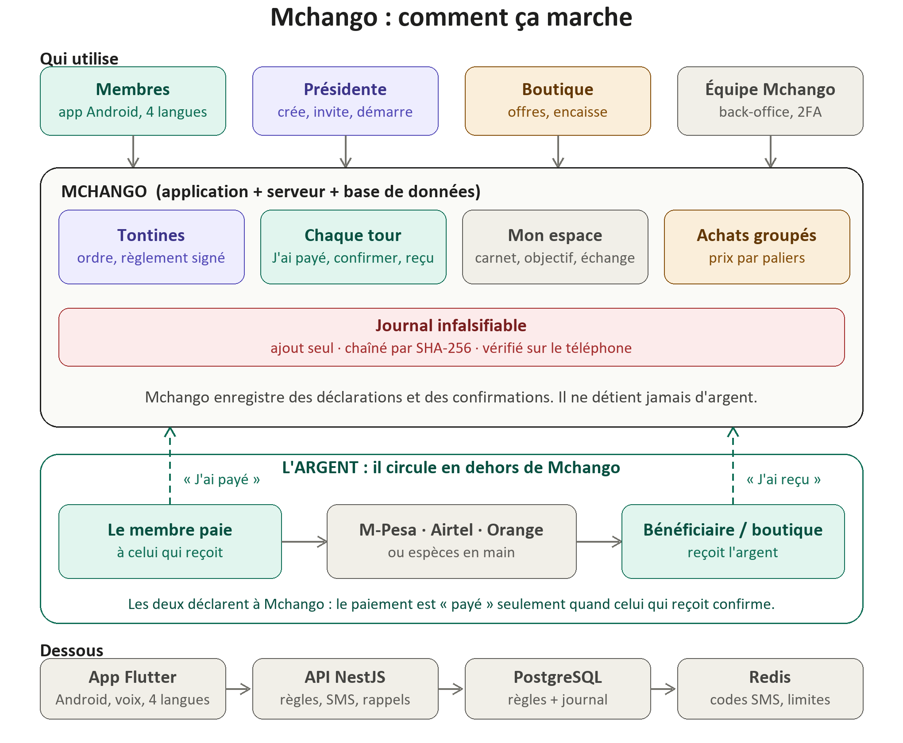
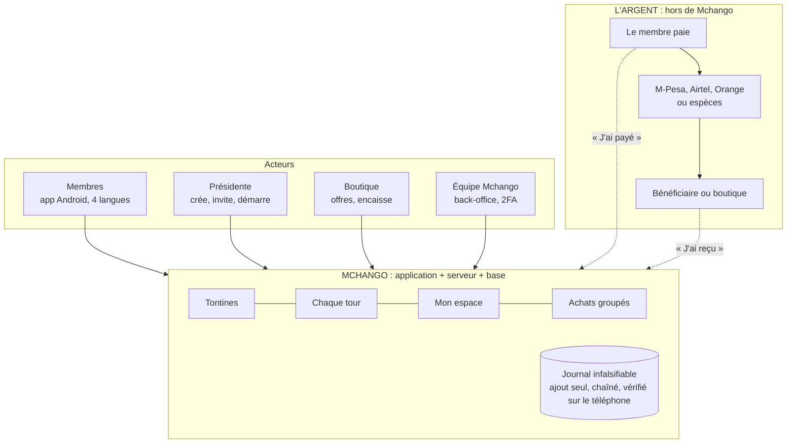

# Mchango : comment fonctionne le logiciel

> Description complète, au 22 novembre 2026. Elle décrit ce qui existe réellement dans le code, et signale ce qui reste à faire (section 14). Pour les détails techniques, chaque section renvoie vers la spécification correspondante dans `spec/` ou `docs/`.

## 1. L'idée en trois phrases

Mchango est une application de **tontine** (likelemba, muziki) pour la RDC. Chaque membre paie le bénéficiaire du tour **par ses propres moyens** (M-Pesa, Airtel Money, Orange Money ou en main), le déclare dans l'app, et le bénéficiaire **confirme** qu'il a reçu. Tout est inscrit dans un **journal que personne ne peut modifier**.

**Règle d'or : Mchango ne détient, ne transfère et ne garantit jamais d'argent.** Il n'y a ni portefeuille, ni cagnotte, ni solde dans la base de données. Mchango enregistre des *déclarations* et des *confirmations*, pas des paiements.

Pourquoi cette règle : elle évite à Mchango d'être une banque ou un service de paiement (réglementation de la Banque centrale), et elle empêche qu'on lui reproche un détournement. Toute fonction qui ferait passer de l'argent par Mchango est refusée tant qu'un juriste congolais ne l'a pas validée.





## 2. Qui fait quoi

| Rôle | Ce qu'il fait |
|---|---|
| **Membre** | Rejoint une tontine, signe le règlement, paie, déclare « J'ai payé », confirme « J'ai reçu » quand c'est son tour. |
| **Président(e)** | Crée la tontine, invite, fixe l'ordre des tours, démarre. Ne confirme jamais à la place d'un autre. |
| **Bénéficiaire du tour** | Celui ou celle qui reçoit à ce tour. Seul(e) à pouvoir confirmer les paiements de ce tour. |
| **Témoin** | Un autre membre qui a vu une remise en espèces ; il confirme en plus du bénéficiaire. |
| **Boutique** (achats groupés) | Publie des offres, encaisse et remet la marchandise. Employés désignés par la boutique. |
| **Équipe Mchango** | Aide les membres via le back-office web. Ne peut jamais confirmer un paiement. |

## 3. Le parcours, de bout en bout

1. **Entrer dans l'app** : choisir sa langue, saisir son numéro, recevoir un code par SMS, choisir un nom et un PIN à 6 chiffres.
2. **Créer ou rejoindre une tontine** : le président crée et partage un **code d'invitation** ; les autres le saisissent et voient les règles avant d'accepter.
3. **Préparer** : le président fixe l'ordre des tours (choisi à la main ou tiré au sort de façon vérifiable) ; **chaque membre signe le règlement** avec son PIN.
4. **Démarrer** : le président appuie sur « Démarrer ». Un tour est créé par membre ; le premier s'ouvre.
5. **À chaque tour** : tous les membres, sauf le bénéficiaire, paient puis déclarent ; le bénéficiaire confirme ; un **reçu avec QR code** est émis.
6. **Fin du tour** : quand tout le monde a payé et que tout est confirmé, le tour se clôt et le suivant s'ouvre. Après le dernier tour, la tontine est terminée.

## 4. La tontine en détail

**Création** (président) : nom, devise (francs ou dollars), montant que chacun paie à chaque tour, **tous les combien (par jour, par semaine ou par mois)**, date du premier tour, nombre de personnes (2 à 100), type de groupe.

- **Fréquence** : jour, semaine ou mois. Trois gros choix à l'écran. Les dates des tours en découlent (31 janvier, puis 28 février, puis 31 mars pour le mensuel).
- **Devise** : francs congolais (FC) ou dollars ($), fixée à la création pour toujours.
- **Type de groupe** : Communautaire, Organisation, Travailleurs, Religion (`spec/categories.md`). Fixé à la création.
  - **Travailleurs** : le président peut caler les échéances sur un **jour de paie** (de 1 à 31, « 31 » = dernier jour du mois) ; si ce jour est un dimanche ou férié, l'échéance est avancée ou reportée au choix. Les collègues **ne voient pas** qui a payé ou qui est en retard, y compris dans le journal (section 8).
- **Part du président** : de **0 à 10 %** de la mise de chaque tour, discutée avec les membres. Elle est dans le règlement que chacun signe, et visible avant de rejoindre. Le **bénéficiaire** de chaque tour la paie au président (hors de Mchango) et la déclare ; le président confirme l'avoir reçue. Au tour du président, rien à payer. Elle ne change plus après le démarrage (`spec/president-fee.md`).
- **Modifier avant le démarrage** : le président peut changer le nom, le montant, la fréquence, la part du président, la date et le nombre de personnes (écran « Modifier la tontine »). Chacun devra alors **signer de nouveau**.
- **Invitation** : un code du type `K7MP-Q2XW`, valable 72 h par défaut (jusqu'à 14 jours), limité à 10 essais par heure et par personne. Les invitations se ferment au démarrage.

**Ordre des tours** : choisi par le président, ou **tiré au sort de façon vérifiable** : une graine aléatoire est publiée, et chacun peut refaire le calcul. Un seul tirage par liste de membres, pour que le président ne relance pas jusqu'à obtenir l'ordre qui l'arrange (`spec/draw.md`).

**Règlement** : montant, devise, fréquence, date de début, mode de versement et ordre des tours. Chaque membre le signe avec son PIN. Si une règle change, les signatures sont annulées. Le démarrage exige la signature de tous.

**Combien reçoit un bénéficiaire** : la somme des paiements des autres membres. Avec N membres et un montant M, chacun reçoit M × (N − 1), moins la part du président s'il y en a une (sauf le président lui-même). Une tontine de 2 personnes n'a que 2 tours, et on ne peut plus entrer après le démarrage : il faut inviter tout le monde avant.

## 5. Un tour : déclarer, confirmer

**Payer** se fait hors de Mchango. Ensuite, le membre appuie sur **« J'ai payé »**.

- **Mobile money** : il choisit l'opérateur et saisit le **numéro de la transaction** (ou colle le SMS de l'opérateur : l'app en extrait le numéro et vérifie le montant). Un même numéro ne peut servir **qu'une fois, dans toute la plateforme**.
- **Espèces** : il désigne un **témoin** du groupe. Le bénéficiaire **et** le témoin doivent confirmer ; la base de données l'impose.
- Le montant déclaré doit être exactement celui du groupe. Renvoyer une déclaration après une coupure réseau ne crée pas de doublon.

**Confirmer** : le bénéficiaire touche **« J'ai reçu »**, ou **« Il y a un problème »** avec un motif. Une déclaration n'est « payée » que lorsque le bénéficiaire a confirmé : **le silence ne vaut pas accord**. Au bout de 72 h sans réponse, l'équipe est alertée.

**Contrôle anti-fraude** : à chaque déclaration, un **niveau de risque** est calculé (vert, orange ou rouge), vu seulement du bénéficiaire, du témoin et de l'équipe.
- **Vert** : rien d'inhabituel.
- **Orange** : le bénéficiaire doit d'abord cocher qu'il a vérifié son solde.
- **Rouge** (mobile money) : il doit en plus coller le SMS de l'argent reçu ; le numéro doit correspondre.
Les raisons (numéro déjà rejeté, date incohérente, SMS non collé, plusieurs déclarations en quelques minutes…) restent cachées du payeur. Ce sont des signaux, jamais des blocages automatiques.

**États d'un paiement** : *Pas encore payé*, *À vérifier* (déclaré), *Payé* (confirmé), *Problème signalé* (contesté), puis rejeté si l'équipe ou un accord le décide ; un paiement rejeté peut être déclaré de nouveau.

**Reçu** : pour chaque paiement confirmé, un reçu avec numéro, montants, noms, et un **QR code** qui renvoie à l'événement du journal. Il se partage en image (WhatsApp). Il atteste d'un accord enregistré, pas d'un transfert garanti par Mchango.

**Rappels SMS** : un SMS par membre et par tour, la veille de l'échéance (le matin même pour le quotidien, le jour de paie pour les Travailleurs), entre 8 h et 20 h heure de Lubumbashi. Il dit **qui payer, combien, à quel numéro, avant quand**, et nomme le bouton « J'ai payé ». Un seul SMS GSM-7 (160 caractères) pour limiter le coût. Pas de nouvel essai automatique en cas d'échec (`spec/reminders.md`).

## 6. Ce que chaque membre a pour lui

- **Mon carnet** : ce que j'ai versé et reçu par devise, mes prochaines étapes (payer qui, recevoir quand), le détail par tontine. Ce sont des montants constatés, pas un solde.
- **Objectif d'épargne** : à quoi servira ma mise (minerval, stock, toiture, moto…), avec montant et date facultatifs. Personnel par défaut ; je peux montrer l'objectif (sans le montant) au groupe. La progression est calculée à partir des paiements confirmés (`spec/goals.md`).
- **Échange de tour** : en cas d'urgence (deuil, minerval, loyer), je propose à un autre membre d'échanger nos tours. Il doit accepter (72 h). Les dates ne changent pas : chacun reçoit à la date de l'autre. Impossible dès qu'un paiement est déclaré pour l'un des deux tours (`spec/swaps.md`).
- **Attestation de régularité** : un relevé figé de mes cotisations (à temps, en retard, tours reçus, ancienneté, montants si je le choisis), avec un **code et un QR** qu'une IMF, une coopec ou un bailleur peut vérifier sans compte. Je peux la retirer. Ce n'est ni un score de crédit ni une garantie (`spec/attestations.md`).
- **Historique vérifié** : tout ce qui s'est passé dans le groupe ; l'app recalcule elle-même la chaîne de hash sur le téléphone et alerte si le serveur présente un contenu différent de ce qu'elle a déjà vérifié.
- **Écouter** : un bouton haut-parleur lit l'essentiel de l'écran à voix haute.

## 7. Achats groupés

« Avec ton groupe, achète moins cher. » (`spec/achats.md`)

1. Une **boutique partenaire** publie une offre à **paliers de prix** (plus il y a de réservations, plus le prix unitaire baisse) avec une date de fin. Une offre publiée ne change plus.
2. Les acheteurs **réservent** leur quantité. Chacun agit pour soi ; l'offre arrive par une zone, un groupe ou un lien WhatsApp. Un achat proposé à un de mes groupes **s'affiche tout seul sur mon accueil** avec « Voir et réserver ».
3. **À la date de fin**, automatiquement : on compte les commandes non annulées ; le **prix final est fixé par la base** au palier atteint. Sous le seuil minimum, l'offre est annulée.
4. Chaque commande reçoit un **code de retrait**. L'acheteur **paie la boutique** (hors Mchango) et déclare le paiement ; **seule la boutique confirme** le paiement et le retrait, contre le code.
5. Après le délai de retrait fixé par la boutique, une commande non retirée expire.

Chaque offre a sa propre chaîne de journal. Déclarer un paiement ne suffit pas : seule la boutique peut le confirmer.

## 8. Le journal infalsifiable

C'est la promesse centrale (`spec/audit-hash.md`, `docs/architecture.md` §4).

- Chaque événement (création, signature, déclaration, confirmation, échange…) est ajouté au journal, **en ajout seul** : ni modification ni suppression, même pour l'équipe ou les administrateurs (la base le refuse).
- Chaque événement contient l'empreinte SHA-256 de **l'événement précédent** : modifier ou retirer un événement casse toute la suite.
- Le journal est **écrit par la base de données elle-même** (déclencheurs), dans la même transaction que l'action : aucun oubli possible.
- Le **téléphone** recalcule la chaîne avec le même algorithme (Dart) ; des vecteurs de test communs garantissent la concordance avec PostgreSQL.
- **Une chaîne par groupe**, une par offre d'achat, et une par membre, pour l'équipe et pour le système.
- **Confidentialité « Travailleurs »** : pour ces tontines, chaque paiement a **sa propre chaîne privée** (`group:<groupe>:slot:<tour>:<payeur>`), visible et vérifiable seulement du payeur, du bénéficiaire du tour, du témoin et du président.
- **Limite honnête** : le journal prouve *qui a affirmé quoi, quand, sans réécriture*. Il ne prouve pas que l'argent a bougé : c'est la double validation qui rend la déclaration crédible.

## 9. Comptes et sécurité

| Sujet | Fonctionnement |
|---|---|
| **Inscription** | Numéro → code SMS à 6 chiffres (valable 5 min, 5 essais, 3 demandes par 15 min et par numéro, stocké haché) → nom + PIN. |
| **PIN** | 6 chiffres, refusé s'il répète un chiffre ou forme une suite. Stocké côté serveur en argon2id ; sur le téléphone, seulement une empreinte PBKDF2. Jamais en clair. |
| **Clé de l'appareil** | Une clé Ed25519 est créée sur le téléphone ; la partie privée ne le quitte jamais. Chaque connexion signe un défi du serveur (jeton de 15 min) : le PIN ne voyage pas à chaque fois. |
| **Verrouillage** | Après 2 minutes en arrière-plan, l'app redemande le PIN (ou l'empreinte digitale si activée). 5 PIN faux sur le téléphone : pause de 5 minutes, annoncée à l'écran. |
| **Nouveau téléphone** | Code SMS **et** PIN ; l'ancien téléphone est déconnecté, et c'est journalisé. |
| **PIN oublié** | Code SMS **et** confirmation d'un **garant** (le président, ou les autres membres si c'est lui) par SMS sur son propre numéro, contre le vol de carte SIM. Sans tontine en cours, le code SMS suffit. Tous les anciens téléphones sont alors déconnectés (`spec/pin-reset.md`). |
| **Signature du règlement** | Confirmée par le PIN (ou l'empreinte), vérifié sur le téléphone. |
| **Protection** | Limites de débit sur codes, invitations, vérification d'attestations ; numéros visibles seulement des membres du même groupe. |

## 10. Pensé pour des mamans peu instruites

Principe fixé par le fondateur : l'UX doit être simple à toutes les couches.

- **Langue d'abord** : le tout premier écran demande la langue (swahili, lingala, français, anglais) en gros boutons. Tous les textes, **y compris les erreurs du serveur** et les SMS, existent dans les 4 langues.
- **Mots du quotidien** : « Qui reçoit », « Payé : 1 sur 3 », « Date du tour », « Il y a un problème », plutôt que « bénéficiaire », « échéance », « contester ».
- **Lisibilité** : texte de 14 px au minimum (16 px courant), zones à toucher d'au moins 48 px, une action principale par écran, un pictogramme sur les boutons, des couleurs qui disent l'état.
- **Erreurs** : message simple qui dit quoi faire, en rouge avec une icône, affiché 8 secondes.
- **Voix** : bouton « Écouter » (accueil, groupe, tour) qui lit l'essentiel lentement, avec les montants dits en mots.
- **Des choix visibles** : la fréquence (par jour, par semaine, par mois) se choisit en trois gros boutons, pas dans un menu caché.

## 11. L'équipe Mchango : le back-office

Application web (Next.js) réservée à l'équipe (`spec/backoffice.md`).

- **Connexion** : e-mail, mot de passe (12 caractères minimum) et **code TOTP obligatoire** ; session de 8 h dans un cookie protégé ; secrets 2FA chiffrés.
- **Modules** : tableau de bord, « À traiter » (PIN oubliés sans réponse, PIN bloqués, litiges, SMS en échec, tontines suspendues), utilisateurs, tontines, litiges, audit, équipe.
- **Rôles** : super admin, conformité, support, finance (numéros masqués), lecture seule. Les droits sont contrôlés **par l'API**.
- **Alertes** : numéro de transaction déclaré plusieurs fois, « PIN oublié » répétés, nouveaux téléphones en série, déclarations rejetées. Des signaux à vérifier, jamais des preuves : **rien n'est bloqué automatiquement**.
- **Limites de l'équipe** : elle ne peut jamais confirmer un paiement ni rejeter un paiement déjà confirmé ; toutes ses actions sont journalisées, et celles qui concernent une tontine sont **visibles des membres**.
- **Avis des membres** : un menu « Donner mon avis » (texte et note), lu par l'équipe. Une **analyse par IA** facultative des tontines et des avis existe : elle ne tourne que si une clé d'accès est configurée, et ses résultats sont consultatifs.

## 12. Architecture technique

```
Téléphone (Flutter) ──HTTPS──> API (NestJS, Node 22) ──> PostgreSQL 16
Back-office (Next.js) ─────────^        │               + journal chaîné
                                        └──> Redis (codes SMS, limites)
                                        └──> Passerelle SMS (console en test)
```

| Élément | Détails |
|---|---|
| **App mobile** | Flutter, Android 7.0 minimum. Aussi servie dans un navigateur pour les tests. Aucun mode hors-ligne complet : elle a besoin du réseau pour afficher et déclarer. |
| **API** | NestJS (monolithe modulaire) : authentification, groupes, cotisations, échanges, objectifs, attestations, achats groupés, rappels, administration, IA. REST en JSON, montants en entiers. |
| **Base** | PostgreSQL 16, 25 migrations (`db/`). Les règles importantes sont **portées par la base** : seul le receveur confirme, un numéro de transaction ne sert qu'une fois, un tour ne change de bénéficiaire que par un échange accepté, le prix final d'une offre est fixé par la base, le journal est en ajout seul. L'API se connecte avec un rôle sans droit de suppression. |
| **Montants** | Entiers dans la plus petite unité : 20 000 FC se stocke `20000`, 20,50 $ se stocke `2050`. Jamais de nombre à virgule. |
| **Redis** | Codes SMS hachés, compteurs de limitation. |
| **Paquet d'audit** | `packages/mchango_audit` (Dart pur) : vérifie la chaîne du journal sur le téléphone. |
| **Tests** | API : 95 tests unitaires et 126 de bout en bout (sur une base à part). Mobile : 83 tests. Base : 5 scripts SQL. Vecteurs communs Dart/Node pour le hash et la signature. |
| **Mise en ligne** | Un seul petit serveur (Docker, HTTPS automatique, sauvegardes nocturnes), décrit dans `docs/mise-en-ligne.md`. Pilote fermé : sans fournisseur SMS, les codes s'affichent dans les journaux du serveur. |
| **Pilote prévu** | 10 à 20 groupes à Lubumbashi. |

## 13. Les chiffres et règles à retenir

- 2 à 100 membres par tontine ; autant de tours que de membres au démarrage.
- Part du président : 0 à 10 % de la mise d'un tour, fixée avant le démarrage.
- Code SMS : 6 chiffres, 5 minutes. PIN : 6 chiffres.
- Invitation : 72 h par défaut. Demande d'échange de tour : 72 h. « PIN oublié » : 48 h.
- Rappel SMS : un par membre et par tour, 8 h à 20 h.
- Une attestation : valable 30, 90 ou 180 jours ; 5 par jour au plus.

## 14. Ce qui n'est pas fait, et ce qu'il faut valider

**À valider avant le pilote**
- **Juridique** (juriste congolais) : le modèle « déclaration sans détention de fonds » face à la réglementation de la Banque centrale ; la protection des données personnelles ; les conditions d'utilisation (Mchango ne garantit, ne rembourse, ne recouvre rien).
- **Traductions** : le swahili et le lingala ont été écrits par un modèle de langage et **doivent être relus par des locutrices**, surtout pour Lubumbashi.
- **Jours fériés de la RDC** pour le calendrier de paie (liste à vérifier dans `db/023_payday.sql`).
- **SMS réels** : choisir un agrégateur couvrant Vodacom, Airtel, Orange et Africell et vérifier la délivrabilité et le coût.
- **Formats réels des SMS d'opérateurs** pour mieux contrôler les numéros de transaction.

**Pas encore développé**
- Mode hors-ligne complet (file d'attente locale).
- Lien WhatsApp qui ouvre directement une offre (nécessite un nom de domaine et les liens d'app Android) ; page web de vérification des attestations.
- USSD, bot WhatsApp, score de confiance, pénalités, rapports PDF, facturation, microcrédit et assurance via des partenaires agréés.
- Catégories Organisation et Religion : seul le socle est en place (rôles, vote du bureau, caisses et promesses à venir) ; dons, dîme et retenue sur salaire exigent un avis juridique avant toute conception.
- Création des boutiques, employés et zones depuis le back-office (aujourd'hui en base).
- Voix en lingala (la voix française est utilisée) et enregistrements par de vraies voix.
- Ancrage périodique des chaînes privées dans le journal du groupe.
- Écrans capturés et repensés un par un : déclarer un paiement, la boutique, l'attestation, l'historique.

**Risques assumés** : la friction de la double validation, la collusion (payeur et receveur d'accord pour mentir, que le journal rend seulement traçable), le risque que Mchango soit vu comme garant, le coût des SMS, et les téléphones basiques tant que l'USSD n'existe pas.

---

*Documents liés : [Cadrage et architecture](architecture.md), [Plan des achats groupés](plan-achats-groupes.md), [Catégories](../spec/categories.md), [Back-office](../spec/backoffice.md), [Mise en ligne](mise-en-ligne.md).*
